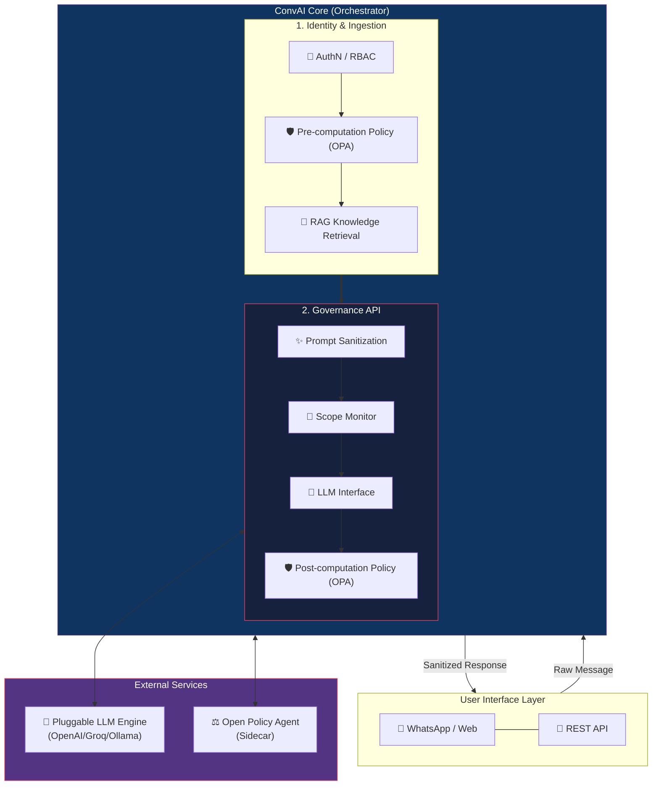

# 🚀 ConvAI Platform — Enterprise-Grade Governed AI

<div align="center">
  
  
  
  
  
</div>

<br/>

Welcome to the **ConvAI Platform**, a revolutionary policy-governed AI architecture designed to safely bridge the gap between human interaction and deterministic, rule-based software systems. 

Unlike standard AI wrappers, ConvAI acts as an intelligent intermediary. It combines the natural conversation capabilities of Large Language Models (LLMs) with the strict, enterprise-grade safety of **Open Policy Agent (OPA)**. This ensures that no AI hallucination, adversarial prompt, or out-of-scope response ever reaches the end user.

---

## 🌟 Executive Summary

For organizations operating in highly regulated industries (e.g., Education, Healthcare, Finance), deploying AI poses significant compliance and reputational risks. **ConvAI eliminates these risks through an invariant "Governed Flow."**

1. **Deterministic Safety:** Every interaction is evaluated against hard-coded business rules *before* and *after* AI generation.
2. **Contextual Awareness:** Seamlessly ingests unstructured data (PDFs, Excel, Word) to provide hyper-accurate, scoped responses.
3. **Pluggable & Extensible:** Vendor-agnostic LLM integration (Groq, OpenAI, Google, Ollama) ensures zero vendor lock-in.

---

## 🏗️ System Architecture

Our architecture is strictly **Policy-Authoritative**. The core orchestration layer (Governance API) intercepts every interaction, enforcing safety via a deterministic policy engine before any probabilistic LLM execution occurs.

### The Governed Flow



### Key Architectural Components

- **Identity Gateway (RBAC):** Dynamically restricts data access based on user roles (e.g., Parent vs. Teacher vs. Admin).
- **Dual-Layer Policy Engine (OPA):** 
  - *Pre-Computation:* Blocks harmful intent, jailbreak attempts, and PII injection before they hit the LLM.
  - *Post-Computation:* Scans the LLM's raw output to ensure compliance with industry rules (e.g., "Never give medical advice").
- **Chain-of-Thought Protocol:** LLMs are forced into an "Internal Reasoning Protocol." They must think step-by-step inside `<thinking>` tags (which are later stripped) before formulating the final answer, dramatically reducing hallucinations.
- **RAG & Vector Database:** Uses ChromaDB for ultra-fast, contextual retrieval from internal organization documents.

---

## 🛠️ Local Development & Setup

ConvAI is built for immediate deployment. You can run the platform via Docker or through native local scripts (optimized for Windows).

### Prerequisites
- [Node.js](https://nodejs.org/) (v20+)
- [Docker Desktop](https://www.docker.com/products/docker-desktop/) (Required for OPA and ChromaDB)
- [Python 3.10+](https://www.python.org/)
- [Ollama](https://ollama.com/) (Optional: For 100% free, offline, local LLM execution)

### 1️⃣ Clone & Configure

```bash
git clone https://github.com/ashishnigam1989/Conv-mvp.git convai-platform
cd convai-platform

# Install dependencies
npm install

# Setup Environment Configuration
cp .env.example .env
```

Open `.env` and set your preferred `LLM_PROVIDER` (`ollama`, `groq`, `openai`, or `gemini`).

### 2️⃣ Start Services (Windows Recommended)

We provide bundled startup scripts that handle initialization, health-checks, and service orchestration.

Ensure **Docker Desktop** and **Ollama** are running, then double-click or run:
```cmd
start-convai.bat
```
*(or `start-conversalx.bat`)*
*This launches the Python LLM orchestration server and the Node.js backend seamlessly.*

To start just the Node.js dev environment:
```cmd
start-dev.bat
```

### 3️⃣ Start Services (Docker Compose)

For isolated containerized deployment of the full stack (App, OPA, ChromaDB, Client):

```bash
docker-compose up -d
```
*(Ensure `host.docker.internal` is mapped if connecting to a host-based Ollama instance).*

---

## 🧪 Testing the Platform

Once the backend is up (`http://localhost:3000`), you can immediately test the governance engine via the Admin API.

```bash
curl -X POST http://localhost:3000/admin/test-message \
  -H "Content-Type: application/json" \
  -H "x-api-key: change-me-in-production" \
  -d '{"text": "What are the latest admission requirements?"}'
```
You will receive a rich JSON response demonstrating the full cycle: Intent Classification -> RAG Context -> AI Reasoning -> OPA Policy Decision -> Final User Response.

---

## 🛡️ Automated Safety Evaluation

Enterprise software requires robust testing. ConvAI ships with a "Gold Dataset" evaluation framework to guarantee policy invariants hold true across software updates.

```bash
# Run the complete test suite (Safety, Quality, Intent)
npm run evals

# Run only critical safety invariants
npm run evals:safety
```

---

## 🤝 Extensibility & Customization

- **Add New Policies:** Write a new `.rego` file and drop it into `src/policies/`. OPA will automatically enforce the new rules in real-time.
- **Custom Knowledge Base:** Drop PDFs, Excel files, or Word documents into the `data/` directory. The RAG pipeline automatically indexes them into ChromaDB.
- **Switch LLMs:** Change the `LLM_PROVIDER` in `.env`. No code changes required.